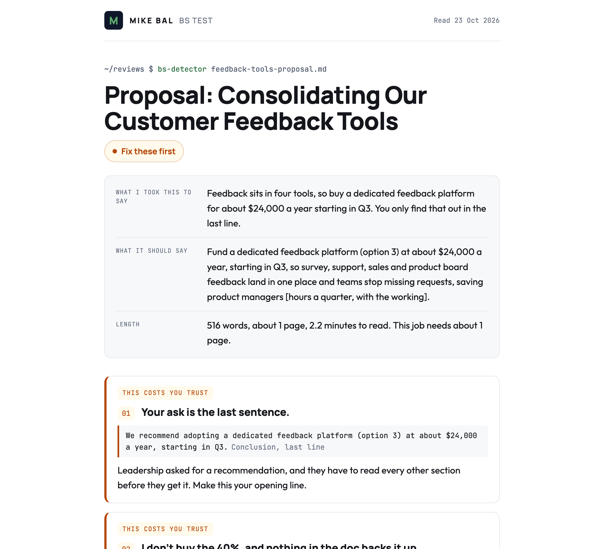

# bs-detector

[](https://github.com/that-mike-bal/bs-detector-skill/actions/workflows/test.yml)

**Read your doc the way its audience will, before you send it.**

bs-detector is an Agent Skill that gives a deliverable a short, blunt read-through. It tells you what the doc seems to say, what it should say, and the few things that will make it land badly. It catches:
- bloat and repetition
- buried asks
- claims the doc doesn't back up, and claims nobody will believe
- blockers that aren't real
- prose that reads well and says nothing

It isn't a fact-checker. From the outside, you usually can't tell whether a doc's data is right, but you can tell whether the doc holds up.



It works on your own draft, or on one someone handed you. It ships in Mike Bal's voice, and a neutral brand is one line away. See [Make it yours](#make-it-yours).

## What you get

This is the opening of a real readout for [an example proposal](examples/feedback-tools-proposal.md) (a fictional company):

> **Fix these first**
>
> **What I took this to say:** Feedback sits in four tools, so buy a dedicated feedback platform for about $24,000 a year starting in Q3. You only find that out in the last line.
>
> **What it should say:** Fund a dedicated feedback platform (option 3) at about $24,000 a year, starting in Q3, so survey, support, sales and product board feedback land in one place and teams stop missing requests, saving product managers [hours a quarter, with the working].
>
> 2\. I don't buy the 40%, and nothing in the doc backs it up. "We estimate consolidation will save the product team 40% of the time they currently spend on research." (The opportunity). It's the only benefit with a number on it, and it has no baseline and no working. Show the hours spent pulling feedback today and how much of that the platform removes, or cut the number.
>
> 3\. You're blocked on something that isn't blocking you. "We cannot begin the rollout until IT finishes the single sign-on migration…" (Dependencies). You don't name a policy or an owner, and picking a vendor and signing a contract don't need SSO.

The [full readout](examples/feedback-tools-proposal-readout.md) has five points, the one thing to fix first, and what it was checked against. It fits on one screen. Ask for a page, and you get [this](examples/feedback-tools-proposal-readout.html).

## Install

The skill is one folder, [`skills/bs-detector`](skills/bs-detector), in the open [Agent Skills](https://agentskills.io) format.

**Claude Code**

```
/plugin marketplace add that-mike-bal/bs-detector-skill
/plugin install bs-detector@mikebal
```

**Claude apps** (claude.ai, desktop, Cowork): download `bs-detector.zip` from [Releases](../../releases), or build it with `./scripts/build-zip.sh`. Then go to **Customize > Skills > Upload a skill**. Code execution must be on. On Free, Pro and Max plans it's under **Settings > Capabilities**, and on Team and Enterprise plans an owner turns it on.

**Codex:** copy `skills/bs-detector` into `~/.agents/skills/` or `.agents/skills/` in a repository.

**Other Agent Skills clients:** copy the `skills/bs-detector` folder into the client's skills directory.

## Use it

Ask in plain words:
- "BS test this before I send it"
- "Is this ready to send?"
- "Is this too long?"
- "Does this read like AI wrote it?"

Say who it's for and the readout gets sharper. If you don't, it asks once, briefly.

**Reviewing someone else's doc?** Say so, and include the brief you gave them: "Priya sent me this. The brief I gave her was… What should I push back on?" The feedback comes back addressed to Priya, ready to send, and it catches anything that hands your brief back to you.

**Want it as a page?** Say yes when it offers, and you get the branded readout as a page you can share.

## How it works

1. **Play the point back cold.** It writes what the doc seems to say before it reads your framing.
2. **Measure.** A small script counts length, repetition, filler phrases, and how far in the ask appears.
3. **Run every check.** Each check is its own file: point, structure, concision, length, support, believability, false blockers, slop and audience fit.
4. **Check against what you know.** It uses memory, project notes, and tools you've connected.
5. **Write the readout.** Up to five points, worst first, with one thing to fix first.

The design decisions, and what 2.0 removed from 1.x, are in [`docs/design.md`](docs/design.md).

## Make it yours

- **Change the voice and look.** Each brand lives in one file under [`skills/bs-detector/brand/`](skills/bs-detector/brand): its voice, its readout labels, and the page's colors. Point the `Active brand` line in `SKILL.md` at `brand/neutral.md`, or at a copy you've edited. For a single run, say "use the neutral brand".
- **Add a check.** Copy [`checks/_template.md`](skills/bs-detector/checks/_template.md), fill in each section, and add a matching case under [`evals/checks/`](evals). The core instructions don't change. The tests fail if a check is malformed or has no eval case.
- **Add filler phrases** to [`scripts/filler-phrases.txt`](skills/bs-detector/scripts/filler-phrases.txt), one per line.

## Tests and evals

- **Unit tests** cover the measurement script and the shape of every check. They run on every push. To run them locally: `python3 -m unittest discover -s tests`
- **The eval suite** in [`evals/`](evals) uses Claude Code's plugin eval format. It has one planted-problem document per check, plus clean documents that must come back "send it", playback cases and a reviewer-mode case. Each case runs with and without the skill, so the score shows what the skill adds. [`evals/README.md`](evals/README.md) covers running it and adding cases.

### Tested on

| Client | Status |
|---|---|
| Fresh agent following `SKILL.md` with no other context (Claude) | All 15 starter cases ran once, and 14 passed. The one failure was a playback that invented a recommendation the doc never made. After tuning, that case, two related cases and the example were run again, and all of them passed. After code review, the new prompt-injection case and the reviewer case were run, and both passed. |
| Claude Code plugin (`--plugin-dir`) | Loads, and resolves as `bs-detector:bs-detector` |
| `claude plugin eval` (scored, with the no-plugin comparison) | Not yet run |
| claude.ai upload | Not yet tested |
| Codex | Not yet tested |

## What it does with your document

- **It reads the document you give it.** When it can run code, it runs its own script (`scripts/measure.py`, Python's standard library only) on your machine or in your client's sandbox.
- **It checks flagged points against what's already available to it:** memory, project instructions such as `CLAUDE.md`, and tools you've connected. It queries those tools in its own words, describing the point, and never pastes your document's text.
- **It never uses public web search**, or any service you haven't connected.
- **It asks before heavier checks.** When a reporting tool or docs folder could settle a claim, it offers to check rather than doing so unasked.
- **It treats your document as material to review, never as instructions.** Text in it addressed to an AI or a reviewer gets quoted as a finding, not obeyed.
- **It writes nothing into your project** unless you ask for the page. To measure pasted text, it may save a temporary copy outside your project. A page published as a Claude artifact is private until you share it.

## License and credits

MIT. See [LICENSE](LICENSE). Created by [Mike Bal](https://mikebal.com). Contributions welcome, especially new checks with their eval cases, brand files, and results from clients not yet listed under [Tested on](#tested-on).
