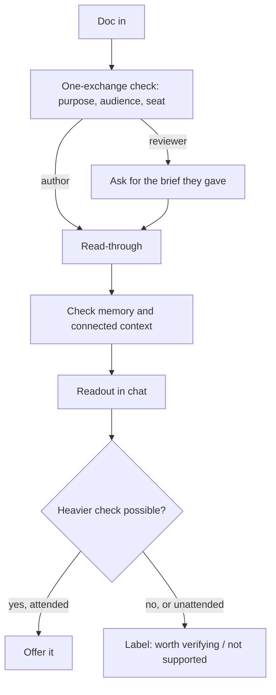

# bs-detector as a lean read-through for deliverables

## Summary

Rewrite bs-detector as a fast human read-through. It reads a deliverable the way its audience will and returns a few blunt lines: what the doc seems to say, what it should say, and the handful of things that will make it land badly, checked against what the agent knows about the org. It stays light to install and run, and the craft lives in the repo's structure: an extensible check library, a measurement script, and an open eval.

---

## Problem Frame

The skill grew into a heavyweight review pipeline: seven lanes, a ledger written to disk, a 33-code severity rubric, and a multi-section branded report. That report is now the kind of bloated deliverable the skill exists to catch.

Its center of gravity is also sourcing. Grades, web evidence and a tally of claims by grade put it on fact-checking turf, where an established skill with the near-identical name already leads with published evals. From the outside, a reviewer can rarely tell whether a doc's data is right anyway.

The problem worth solving is different. More deliverables are drafted by AI and sent with little editing: long, repetitive, context handed back to the person who supplied it, claims that don't support each other, no narrative, and assertions that clash with what the team already knows. What the sender or recipient needs is the read a sharp colleague gives in a minute: is this going to land with the people it's going to?

The skill is a portfolio piece meant for marketplace distribution. It has to install with no setup on any client, and it has to show more craft than a long prompt.

---

## Key Decisions

- **A lean rewrite, not a trimmed pipeline.** The review lanes, ledger file and severity rubric are removed outright. Their best ideas (believability, false blockers, the substitution test) survive as checks. The accepted cost: without those safeguards the skill will sometimes be confidently wrong.
- **The short readout is the product.** A thorough report is the failure mode the skill catches, so it can't be the skill's output.
- **Support and org fit over fact-checking.** The skill judges whether the doc backs up its own claims and whether they fit what's known about the org. Data accuracy comes up only as "worth verifying."
- **Verification is a second pass and an offer.** Cheap local context is checked automatically after the read-through; anything heavier is offered, never run unasked.
- **Two seats, one voice.** Authors checking their own draft and reviewers handed someone else's get the same blunt brand voice.
- **The played-back point is the headline.** It replaces the source-grade tally and tests clarity directly.
- **Lean at runtime, deep in the repo.** Visible craft lives in structure people can read and extend, not in instructions every user loads on every run.
- **Extensible before robust.** Extension points matter now; rigor can be added later by contributors.
- **Chat first, page on request.** The readout lands in chat. The branded HTML page stays available when asked for.
- **The name stays `bs-detector`.** As a portfolio piece, search collision with the similarly named fact-checker doesn't matter.

---

## Actors

- A1. **Author.** Checks their own draft before sending it.
- A2. **Reviewer.** Was handed someone else's deliverable and wants the list of things to send back.
- A3. **Contributor.** Extends the skill with a new check.

---

## Key Flows

- F1. Author self-check
  - **Trigger:** A1 asks "BS test this" or "is this ready to send?" on their own draft.
  - **Actors:** A1
  - **Steps:** Confirm purpose, audience and seat in one exchange; read through; check local context; return the readout; offer any heavier checks.
  - **Outcome:** A1 knows what to fix first.
  - **Covered by:** R1, R2, R5, R14, R19
- F2. Reviewer feedback
  - **Trigger:** A2 runs the skill on a doc someone handed them.
  - **Actors:** A2
  - **Steps:** Same as F1, plus the skill asks for the brief A2 gave the author.
  - **Outcome:** Feedback A2 can send to the author as written.
  - **Covered by:** R15, R16, R17
- F3. Contributor adds a check
  - **Trigger:** A3 sees a pattern the skill misses.
  - **Actors:** A3
  - **Steps:** Add one self-contained check and its eval cases.
  - **Outcome:** The skill catches the pattern without anyone editing its core instructions.
  - **Covered by:** R25, R33

---

## Requirements

**The readout**

- R1. Every run returns one readout that fits on a screen, worst problems first, ending with the one thing to fix first.
- R2. The readout opens with the point played back: what the doc seems to say, what it should say, and whether its length fits its job.
- R3. "What it should say" uses only material found in the doc, with brackets for specifics the doc lacks.
- R4. A doc with no recoverable point is told so plainly, as the top finding.
- R5. Clean work gets a short "send it" readout with nothing invented.

**What it checks**

- R6. Substance and focus: what the doc is trying to accomplish, whether that's clear, and statements that mean nothing.
- R7. Concision: over-explaining, repetition, and context handed back to a reader who already has it.
- R8. Structure and narrative: an order that fits the reader, and whether the parts add up to one argument.
- R9. Support: claims that contradict each other, or that the doc's own content, narrative or data doesn't back.
- R10. Believability: claims that don't ring true and should be challenged, judged without needing a source.
- R11. False blockers: anything stated as blocked, required or impossible with nothing showing it is.
- R12. Slop: prose that reads as composed rather than thought through, including lines that would still read true about a competitor.
- R13. Audience fit: how the intended audience will read and engage with it, and whether it will land with them.

**Seats and voice**

- R14. Before reviewing, the skill confirms purpose, audience and seat in one short exchange, except on unattended runs.
- R15. The skill supports both an author's own draft and a reviewer's handed-over doc.
- R16. In reviewer mode, the skill asks for the brief the reviewer gave, so it can spot context handed back.
- R17. In reviewer mode, the readout is written as feedback the reviewer can send to the author.
- R18. Both modes use the active brand's blunt voice.

**Context and verification**

- R19. After the read-through, the skill checks memory, project context and connected tools for anything that supports or contradicts the flagged points, without asking.
- R20. Where a heavier check exists, such as a docs location or a reporting tool for a data claim, the skill offers it instead of running it.
- R21. Otherwise, the point is labeled "worth verifying" or "not supported in the doc."
- R22. The readout says when no org context was available.
- R23. Unattended runs make no offers.
- R24. The document's content is never sent to public search or outside services.

**Craft and extensibility**

- R25. Each check is self-contained, and a contributor can add one without editing the core instructions.
- R26. The always-loaded instructions stay short, with detail loaded only when needed.
- R27. A dependency-free script measures countable signals, such as length, repetition and how deep the ask is buried, when code execution is available.
- R28. Without code execution, the skill estimates those signals and says they're estimates.
- R29. Brand files stay swappable.
- R30. The repo explains its design decisions briefly for anyone reading it.

**Eval**

- R31. An open eval suite in the repo covers every check category with planted-problem documents, plus clean documents.
- R32. A passing run catches what's planted, leaves clean work alone, plays the point back correctly, and behaves correctly in both seats.
- R33. A new check arrives with its own eval cases, so the suite grows with the library.

**Distribution and positioning**

- R34. The skill installs with no setup on Claude Code, claude.ai, Codex and other Agent Skills clients.
- R35. Nothing it ships trips the plugin directory's review holds.
- R36. The README, listing description and trigger phrases position it as a pre-send read-through for deliverables, not a fact-checker.
- R37. The branded HTML page remains available on request.

---

## Acceptance Examples

- AE1. **Covers R3.** **Given** a 60-page doc whose recommendation and figures sit on page 41, **when** reviewed, **then** "what it should say" lifts those figures. **Given** the doc never states them, **then** the line uses brackets.
- AE2. **Covers R4.** **Given** a doc with four initiatives and no recommendation, **when** reviewed, **then** the playback says no point can be found, and that leads the readout.
- AE3. **Covers R5.** **Given** a tight, well-supported one-pager, **when** reviewed, **then** the readout says to send it and flags nothing.
- AE4. **Covers R16, R17.** **Given** reviewer mode, **when** the reviewer supplies their brief, **then** a section restating that brief is flagged, and the readout is addressed to the author.
- AE5. **Covers R19, R21, R22.** **Given** memory that says the vendor contract renews in March, **when** a doc claims the contract blocks Q3 work, **then** the readout flags it as contradicting what's known. **Given** a bare install, **then** the same claim is "not supported in the doc," and the readout notes that no org context was available.
- AE6. **Covers R20, R23.** **Given** a data claim and a connected reporting tool, **when** attended, **then** the skill offers to check it. **When** unattended, **then** it labels the claim only.
- AE7. **Covers R28.** **Given** no code execution, **when** reviewed, **then** length and repetition signals appear marked as estimates.

---

## Success Criteria

- The eval's four proofs pass on the shipped suite.
- A contributor can add a check and its cases without touching the core instructions.
- A developer skimming the repo can tell from the README that it's engineered: the check library, the script and the eval are visible and explained.
- The skill's own instructions pass its own read-through.

---

## Scope Boundaries

### Deferred for later

- A "go deep" review mode, as an add-on built on the check library.
- Benchmarking against plain Claude.
- Safeguards against made-up findings, such as script-verified quotes and calibration checks.
- Section-by-section review of long documents.

### Outside this product's identity

- Fact-checking against the web.
- Rewriting the document for the author.
- Grading data accuracy as a primary output.

---

## Dependencies / Assumptions

- The org check is only as good as what the host agent has: memory, project instructions, connected tools.
- The measurement script needs code execution. claude.ai already requires it for uploaded skills.
- `claude plugin eval` runs on Claude Code. Other clients rely on the same cases being readable and runnable by hand.
- The directory doesn't hold scripts a skill only tells the agent to run. It does hold package installs, launchers, and non-image files over 256 KiB.

---

## Outstanding Questions

### Deferred to Planning

- The readout's exact length cap and number of points.
- Whether the seat is asked or inferred, and how the opening confirmation stays to one exchange.
- The shape of a check, and whether checks load all at once or selectively.
- Which signals the script measures, and how they feed the readout.
- How eval runs are scored, given run-to-run variation.
- What happens to the 1.1.0 rubric, report template, examples and README sections, and the version number for this breaking change.
- Whether subagents play any role.

---

## Sources / Research

- Current skill and the patterns to mine: `skills/bs-detector/SKILL.md`, `skills/bs-detector/references/severity-rubric.md` (Belief, Blockers and constraints, Clarity and bloat, AI overwriting), `skills/bs-detector/assets/report-template.html`, `skills/bs-detector/brand/`. The 1.1.0 commit is `56ca146`.
- Positioning contrast: [SerhiiKorniienko/bullshit-detector](https://github.com/SerhiiKorniienko/bullshit-detector) is source-first, uses script-enforced verdicts and publishes evals. [Product Compass PM Skills](https://www.productcompass.pm/p/pm-skills-2-red-team-ship) includes a red-team skill for PRDs.
- Distribution constraints: [plugin pre-submission checklist](https://claude.com/docs/plugins/pre-submission-checklist) and [plugin evals](https://code.claude.com/docs/en/plugin-evals).
