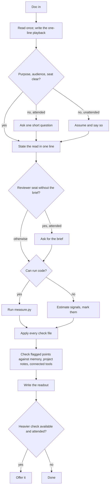
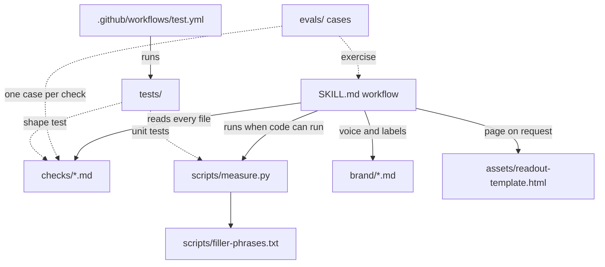

# feat: Rewrite bs-detector as a lean read-through with checks, measurement and evals

## Summary

Replace the 1.1.0 review pipeline with a short skill that reads a deliverable the way its audience will and returns a few blunt lines. Put the craft where repo readers can see it and installers don't pay for it: a library of check files anyone can extend, a stdlib Python script for the countable signals, an open eval suite in Claude Code's plugin-eval format, unit tests, and a CI job that runs them.

---

## Problem Frame

1.1.0 runs seven lanes, writes a ledger to disk, grades claims against a 33-code rubric, and publishes a multi-section report. Its output is the bloated deliverable the skill exists to catch, and its center of gravity is sourcing, which is fact-checking turf the product is leaving (see origin: docs/brainstorms/2026-10-07-taste-read-through-requirements.md).

The rewrite has to stay cheap to install and run on every Agent Skills client, while showing anyone who opens the repo that it's engineered rather than one long prompt.

---

## Requirements

Requirements R1–R37 carry over from the origin unchanged except R14, which this plan adjusts. R38 and R39 are added by this plan.

| ID | Requirement (abridged) | Delivered by |
|---|---|---|
| R1 | One readout that fits a screen, worst first, ending with the one thing to fix first | U4 |
| R2 | Opens with the point played back: seems to say, should say, length fit | U4 |
| R3 | "Should say" uses only the doc's material, brackets for gaps | U4 |
| R4 | No recoverable point is said plainly, as the top finding | U3, U4 |
| R5 | Clean work gets a short "send it" with nothing invented | U4 |
| R6–R13 | The checks: substance and focus, concision, structure and narrative, support, believability, false blockers, slop, audience fit | U3 |
| R14 (adjusted) | States its read of purpose, audience and seat in one line when the request makes them clear; asks one short question only when it can't infer them; never asks on unattended runs | U4 |
| R15–R18 | Both seats; reviewer mode asks for the brief and writes feedback to the author; one blunt voice | U4, U5 |
| R19–R24 | Local context check after the read-through, offers for heavier checks, "worth verifying" labels, says when no context, no offers when unattended, nothing sent to public services | U4 |
| R25 | A check can be added without editing core instructions | U3 |
| R26 | Always-loaded instructions stay short | U4 |
| R27–R28 | Dependency-free measurement script when code runs; marked estimates otherwise | U1, U4 |
| R29 | Brand files stay swappable | U5 |
| R30 | The repo explains its design briefly | U8 |
| R31–R33 | Open eval suite: every check category, clean docs, the four proofs, new checks arrive with cases | U6, U7 |
| R34–R35 | No-setup install on every client; nothing trips the directory's review holds | U4, U8 |
| R36 | README, listing and triggers position it as a pre-send read-through | U8 |
| R37 | Branded page on request | U5 |
| R38 | A CI job runs the unit tests on every push and pull request, with no model calls | U2 |
| R39 | Ships as 2.0.0 with a changelog entry that tells brand-file forks what changed | U8 |

---

## Key Technical Decisions

- **Checks are files, discovered by listing a directory.** Each check is one markdown file in `skills/bs-detector/checks/`. The skill reads every file there except those starting with `_`, so adding a check never touches `SKILL.md` (R25).
- **Every check has the same shape.** Frontmatter `name` and `summary`, then sections for what to look for, how to tell, what doesn't count, when it's worst, and how it reads in the readout. `_template.md` defines the shape, and a unit test enforces it so contributor mistakes fail in CI rather than at review time.
- **Three plain levels replace the 33-code rubric.** "Stops it", "costs trust", "slows the reader". Each check's "when it's worst" section says what pushes it to the top level. Worst-first ordering survives without the rubric's weight.
- **One root cause, one point.** Checks overlap, so the readout merges findings that share a cause into one numbered point and keeps the strongest quote. Five slots can't go to the same problem twice.
- **Overlapping concerns share a check file.** Concision covers over-explaining, repetition and handed-back context. Structure covers order and narrative. Every concern the origin lists is still checked, and nine files instead of twelve cut the double-flagging at the source.
- **One pass, no subagents.** The blind read survives as a step: the skill writes its one-line playback before it reads the request's framing. This keeps 1.x's cold-reader control without a second agent.
- **The opening question is conditional (R14 adjusted).** Eval runs are non-interactive, and asking for context the request already gave is friction.
- **The readout format is fixed in `SKILL.md`.** Up to five numbered points under the playback, then "Fix first", a context line, and any offer. Labels come from the brand file.
- **The measurement script is stdlib Python 3.8+.** It reads a text or markdown file, or stdin, and prints JSON. It lives in the skill folder so the claude.ai zip carries it. The filler-phrase list is a plain text file beside it that contributors can extend. Signals are evidence the readout cites, never verdicts on their own. Heuristics are English-only.
- **Every check loads on every run.** Nine short checks cost about 2,000 words, under a third of 1.1.0's instructions. Selective loading would need a rule that guesses which checks matter before reading the doc, and a skipped check fails silently. Revisit if the library passes roughly 25 checks.
- **Org context means what the user already has, queried in the reviewer's own words.** Memory, project instructions, and tools the user has already connected are in scope. A query to a connected tool describes the flagged point in the reviewer's words and never pastes document text. Public search and services the user hasn't connected are out. This is how the context check (R19) and the no-outside-services rule (R24) coexist. The readout's context line names what was consulted, or says nothing was available.
- **Evals use Claude Code's plugin-eval format, not skill-creator's.** Cases live in `evals/` with `prompt.md` and `graders/`. Each run starts empty, doesn't expand `@` mentions, and loads no memory, so fixture documents go inline in the prompt body and org context is simulated with `append_system_prompt`.
- **Graders favor short, stable checks.** Each case pairs an `llm` grader with concrete PASS/FAIL rubrics on the readout (which is short, so judging stays steady) with `regex` graders for readout shape, plus a `tool_used: Skill` indicator. The documented pass bar is `--threshold 0.8`.
- **The suite starts small and grows.** The starter suite has one case per check in `evals/checks/<check-name>/`, plus clean-document, played-back-point, readout and reviewer-seat cases. Together they cover the origin's four proofs. More cases get added when something breaks, not up front, because every case costs six model runs.
- **Script-path eval cases come later.** `--allow-tools` applies to a whole run, so script and no-code fallback cases would need separate tagged runs (`needs-bash`, `no-bash`). The starter suite skips both. Unit tests cover the script, and U8 checks the fallback by hand.
- **The plain-Claude comparison is recorded, not published.** The eval runner reports `Δ` for free. `evals/README.md` records the latest with and without scores. Public claims from it stay deferred.
- **1.1.0 machinery is deleted outright.** The rubric, ledger convention, lanes and old example go. Commit `56ca146` holds them and is the quarry for the check files.
- **The page template shrinks to the readout's shape.** The template keeps the brand-token and dark-mode contract and drops the tally, coverage cards and severity chips. Chat stays the default.
- **The README stays short because it is the directory listing.** Design rationale lives in `docs/design.md`, linked from a short "How it works" section.
- **CI runs unit tests only.** GitHub Actions runs `tests/` on Python 3.8 and the current release. The eval suite stays manual because it spends model usage.

---

## High-Level Technical Design

### Runtime flow



### Components



### Readout shape

The shape the skill writes. Labels come from the active brand file.

```text
<verdict label>                                  e.g. "Don't send it yet"
What I took this to say: <one line, written before reading the framing>
What it should say: <one line from the doc's own material; [brackets] for gaps>
Length: <measured, or "~" if estimated>. This job needs about <n>.

1. <Problem said out loud.> "<short quote>" (<where>). <Why, one sentence.> <Fix, one sentence.>
   ... up to 5, worst first

Fix first: <one line>
Checked against: <memory / project notes / tool names>  |  No org context available.
<Offer, attended only: "I can check #3 against <tool>. Want me to?">
```

In reviewer mode it opens with `To <author>, re: <doc>` and speaks to the author.

### Behavior by condition

| Condition | Behavior |
|---|---|
| Purpose, audience and seat clear from the request | One-line statement of the read, no question |
| Unclear, attended | One short question, then review |
| Unclear, unattended | Assume, state the assumption, review |
| Reviewer seat, brief given | Address the author; run the handed-back-context check |
| Reviewer seat, no brief, attended | Ask for the brief |
| Reviewer seat, no brief, unattended | Review, and say handed-back context wasn't checked |
| Code can run | Cite measured signals |
| Code can't run | Cite estimates, marked as estimates |
| Org context available | Context line names what was consulted |
| No org context | Context line says none was available |
| Heavier check possible, attended | Offer it |
| Unattended | No questions, no offers, labels only |

---

## Output Structure

```text
.github/workflows/test.yml
skills/bs-detector/
  SKILL.md                      rewritten, lean
  checks/
    _template.md
    point.md  structure.md  concision.md  length.md  support.md
    believability.md  false-blockers.md  slop.md  audience-fit.md
  scripts/
    measure.py
    filler-phrases.txt
  brand/mikebal.md  brand/neutral.md        trimmed
  assets/readout-template.html              replaces report-template.html
  agents/openai.yaml
tests/
  test_measure.py
  test_checks.py
evals/
  README.md
  checks/<check-name>/prompt.md, graders/
  clean/  playback/  readout/  seats/
docs/design.md
examples/                                   new example replaces the 1.1.0 one
```

Removed: `skills/bs-detector/references/severity-rubric.md`, `skills/bs-detector/assets/report-template.html`, `examples/onboarding-plan*`, `examples/screenshots/report-*.png`.

---

## Implementation Units

### Phase 1: Foundations

### U1. Measurement script and its tests

**Goal:** A dependency-free script that turns a document into countable signals the readout can cite.

**Requirements:** R27, R28, R35

**Dependencies:** None

**Files:**
- Create: `skills/bs-detector/scripts/measure.py`
- Create: `skills/bs-detector/scripts/filler-phrases.txt`
- Test: `tests/test_measure.py`

**Approach:**
- Input is a file path argument or stdin. Output is one JSON object on stdout.
- Signals: word count, estimated pages and reading minutes; sentence count and share of long sentences; repetition (share of sentences that substantially repeat an earlier one, and phrases repeated three or more times); filler-phrase hits per 1,000 words, with the phrases found; ask position (how far into the doc, as a fraction, the first recommendation or ask marker appears, or null).
- Strip markdown syntax (headings, list markers, emphasis, code fences) before counting.
- Non-text input exits non-zero with a one-line message, so the skill falls back to estimates.
- `filler-phrases.txt` holds one phrase per line, with `#` comments, seeded from 1.1.0's AI-overwriting and voice tables.

**Execution note:** Test-first. The script is the one deterministic component, and the tests are what CI guards.

**Patterns to follow:** Pattern rows under "Clarity and bloat" and "AI overwriting" in `skills/bs-detector/references/severity-rubric.md` at commit `56ca146`.

**Test scenarios:**
- Happy path: a 1,000-word fixture reports 1,000 words, about two pages, and a reading time within one minute of words divided by 238.
- Happy path: a fixture where one sentence appears three times reports a repetition share above zero and lists the phrase among repeated phrases.
- Happy path: a fixture containing "it's worth noting" and "in today's landscape" reports both phrases and a matching hits-per-1,000 value.
- Happy path: an ask sentence ("We recommend raising Pro to $49") placed about 70% through reports an ask position between 0.65 and 0.75.
- Edge case: a doc with no ask markers reports a null ask position.
- Edge case: empty input returns zeros and nulls without raising.
- Edge case: markdown headings, bullets and code fences don't count as words or sentences.
- Edge case: stdin input produces output identical to the same text passed as a file.
- Error path: binary input, such as a PNG, exits non-zero with a one-line message on stderr.
- Integration: a fixture of about 30,000 words finishes within two seconds.

**Verification:** `tests/test_measure.py` passes on Python 3.8 and current Python, and the script imports nothing outside the standard library.

---

### U2. CI for unit tests

**Goal:** Every push and pull request runs the unit tests, so the script and the check shape can't silently break.

**Requirements:** R38

**Dependencies:** U1 (U3's shape test joins once it lands)

**Files:**
- Create: `.github/workflows/test.yml`

**Approach:** Run on push and pull_request. Test against Python 3.8 and the current Python release, using the standard-library test runner over `tests/`. No secrets, no model calls, no network beyond checkout.

**Test expectation:** none, because the workflow is the test harness. Verify it by observing runs.

**Verification:** A pushed commit shows a passing run. A deliberately broken test on a branch shows a failing run.

---

### U3. Check library

**Goal:** Nine self-contained checks covering every item on the origin's list, plus a template that makes adding one obvious.

**Requirements:** R4, R6–R13, R25, R33 (shape side); F3

**Dependencies:** None (U2 runs its shape test once both land)

**Files:**
- Create: `skills/bs-detector/checks/_template.md`
- Create: `skills/bs-detector/checks/point.md`, `structure.md`, `concision.md`, `length.md`, `support.md`, `believability.md`, `false-blockers.md`, `slop.md`, `audience-fit.md`
- Test: `tests/test_checks.py`

**Approach:**
- Mine 1.1.0 where it applies:
  - "Belief" table → `believability.md`
  - "Blockers and constraints" table → `false-blockers.md`
  - "Clarity and bloat" table → `point.md`, `concision.md`, `structure.md`
  - "AI overwriting" table, the substitution test and "says nothing" → `slop.md`
  - Numbers and logic tables → `support.md`
  - Voice and audience patterns → `audience-fit.md`
- `length.md` is new, as are the handed-back-context part of `concision.md` and the narrative part of `structure.md`.
- Each check names the signals from `measure.py` it may cite, so the readout has numbers to point at.
- Each "doesn't count" section carries the taste guard: prose you'd write differently is not a finding.
- Aim for about 150–300 words per check.

**Patterns to follow:** The pattern tables and worked examples in `skills/bs-detector/references/severity-rubric.md` at commit `56ca146`, and the voice phrase groups (belief, clarity, blocked) in `skills/bs-detector/brand/mikebal.md`.

**Test scenarios:**
- Happy path: every non-underscore file in `checks/` has `name` and `summary` frontmatter and all required section headings.
- Edge case: frontmatter `name` matches the filename without `.md`.
- Edge case: `_template.md` is excluded from the shape test's required-content rules but has every heading.
- Error path: a fixture check missing a section makes the test fail with a message naming the file and the section.
- Integration: every check has a matching `evals/checks/<name>/` case directory. This test fails until U6 lands, so add it in U6.

**Verification:** `tests/test_checks.py` passes, and each check reads as one coherent, specific instruction.

---

### Phase 2: The skill

### U4. Lean SKILL.md and removal of 1.1.0 machinery

**Goal:** A short workflow that produces the readout, wired to the checks and the script.

**Requirements:** R1–R5, R14 (adjusted), R15–R24, R26, R28, R34; F1, F2

**Dependencies:** U1, U3

**Files:**
- Modify: `skills/bs-detector/SKILL.md` (full rewrite, version 2.0.0 in metadata)
- Delete: `skills/bs-detector/references/severity-rubric.md`
- Test: `evals/` cases from U6

**Approach:**
- The steps follow the runtime-flow diagram. The readout section follows the readout shape. The rules and guardrails follow the behavior table.
- Description and trigger phrases cover the pre-send moment and the reviewer moment: "BS test this", "is this ready to send", "is this too long", "Dana sent me this, what should I push back on", "does this read like AI wrote it". Stay under the 1,024-character description limit.
- Guardrails to keep: never invent numbers or quotes; quotes are verbatim; taste is not a finding; slop is a shape, not an accusation; nothing goes to public search or outside services; unattended means no questions and no offers.
- Script invocation resolves the path relative to the skill's own directory. Fall back to estimates when code can't run or the script errors.
- Keep the file to about 1,500 words. Detail belongs in the checks.

**Patterns to follow:** The 1.1.0 `SKILL.md` capability-fallback table and its unattended-run rules, compressed.

**Test scenarios:** Covered by U6 cases. Each scenario there names its origin AE.

**Verification:** U7's suite meets the threshold, and running the skill on its own `SKILL.md` produces a readout with nothing at the "stops it" level.

---

### U5. Brand files and the readout page

**Goal:** Brand files that carry voice, readout labels and tokens. A page template that renders the readout when someone asks for one.

**Requirements:** R18, R29, R37

**Dependencies:** U4

**Files:**
- Modify: `skills/bs-detector/brand/mikebal.md`, `skills/bs-detector/brand/neutral.md`
- Create: `skills/bs-detector/assets/readout-template.html`
- Delete: `skills/bs-detector/assets/report-template.html`

**Approach:**
- Brand files drop the tally, coverage, severity-chip and flag-label placeholders.
- They gain readout labels: verdict labels, "What I took this to say", "What it should say", "Length", "Fix first", "Checked against", "No org context available", and the reviewer opener.
- Voice phrase groups stay.
- The template keeps the brand-token block, dark-mode contract, masthead and footer. It renders the playback, up to five points, "Fix first" and the context line.

**Patterns to follow:** The token and dark-mode blocks and the header-comment placeholder guide in the current `report-template.html`.

**Test expectation:** none (automated). Evals can't publish pages. Check it by hand: render once in light mode at desktop width and once in dark mode at phone width.

**Verification:** Both brands render a sample readout cleanly in both modes, and no `{{PLACEHOLDER}}` is left unfilled.

---

### Phase 3: Proof

### U6. Eval suite

**Goal:** An open suite that proves the four things the origin requires and grows one case per check.

**Requirements:** R31, R32, R33; F3

**Dependencies:** U3, U4

**Files:**
- Create: `evals/README.md` (how to run, the two tag commands, cost note, how to add a check's case, latest scores)
- Create: `evals/checks/<check-name>/prompt.md` and `graders/` for each of the nine checks
- Create: `evals/clean/`, `evals/playback/`, `evals/readout/`, `evals/seats/` cases
- Modify: `.gitignore` (add `evals/results/`)
- Modify: `tests/test_checks.py` (add the check-to-case pairing test)

**Approach:**
- Fixture documents go inline in prompt bodies, phrased the way a user would paste them. Prompts state purpose, audience and seat.
- Every case pairs an `llm` grader with concrete PASS/FAIL conditions with a `regex` grader for readout shape (the playback labels are present, and there are no more than five numbered points). The `tool_used: Skill` indicator is added too.
- Set `max_turns` and `timeout_seconds` generously.

**Execution note:** Write each case's graders before tuning anything in U7, so the bar isn't fitted to the output.

**Test scenarios:**
- Happy path: one case per check under `evals/checks/`. Each document plants that check's problem, and the grader passes only when the readout flags it.
- Covers AE3. Two clean documents (a tight one-pager and a long reference doc whose length fits its job) come back "send it" with no numbered points.
- Covers AE1. A doc whose recommendation and figures sit late has "what it should say" lift those figures.
- Covers AE2. A doc with four initiatives and no recommendation leads with "no point found".
- Covers AE4. A reviewer-mode case with the brief supplied opens to the author and flags the section restating the brief.
- Edge case: in `evals/readout/`, a doc whose restated brief is also its main source of bloat gets one numbered point for it, not two.

**Verification:** Every case loads (`claude plugin eval .` reports no load errors), and the pairing test in `tests/test_checks.py` passes.

---

### U7. Tune against the suite

**Goal:** Bring the suite to the threshold by changing the skill, never the graders.

**Requirements:** R32

**Dependencies:** U6

**Files:**
- Modify: `skills/bs-detector/SKILL.md`, `skills/bs-detector/checks/*.md` as findings demand
- Modify: `evals/README.md` (latest with and without scores, date, models used)

**Approach:**
- Run each group with `--ablation none` while iterating, then run the full two-arm suite once with pinned `--model` and `--judge-model`.
- A failing grader gets its rubric tightened only when the report shows the judge misread a correct readout. That change is noted in `evals/README.md`.

**Test expectation:** none beyond the suite itself.

**Verification:** The full suite meets `--threshold 0.8` in a two-arm run, and the recorded `Δ` is positive.

---

### Phase 4: Ship

### U8. Example, positioning and release

**Goal:** The repo explains and shows the new product, and ships as 2.0.0.

**Requirements:** R30, R34, R35, R36, R39

**Dependencies:** U5, U7

**Files:**
- Delete: `examples/onboarding-plan.md`, `examples/onboarding-plan-bs-test.html`, `examples/onboarding-plan-ledger.md`, `examples/screenshots/report-dark-phone.png`, `examples/screenshots/report-light-desktop.png`
- Create: a new example input document, its readout, its page and fresh screenshots under `examples/`
- Create: `docs/design.md`
- Modify: `README.md`, `CHANGELOG.md`, `.claude-plugin/plugin.json`, `.claude-plugin/marketplace.json`, `skills/bs-detector/agents/openai.yaml`

**Approach:**
- Produce the example by running the finished skill on a realistically bloated, AI-flavored doc. Don't hand-write the readout.
- README order:
  1. Positioning line
  2. The example readout inline
  3. Install
  4. Use
  5. "How it works", short and linking `docs/design.md`
  6. Extend (add a check, add a brand)
  7. Evals and CI badge
  8. "Tested on", updated from the client checks below
  9. "What it does with your document", disclosing the local script, how connected tools are queried, and the offers
- `docs/design.md` covers the blind playback, one pass without subagents, checks as files, script versus judgment, the eval design, and what was removed from 1.1.0 and why.
- `CHANGELOG.md` gets the 2.0.0 entry. It includes a short migration note for anyone with a custom brand file.
- Update descriptions and set version 2.0.0 in `plugin.json`, the `SKILL.md` metadata, `openai.yaml` and `marketplace.json`.
- Confirm `scripts/build-zip.sh` packs `checks/` and `scripts/`. It zips the whole skill folder, so no change is expected.

**Test expectation:** none (documentation and metadata). Verify by hand.

**Verification:**
- The skill's own read-through of `README.md` lands nothing at "stops it".
- `claude plugin validate .` passes.
- The rebuilt zip contains `checks/` and `scripts/`.
- No file outside `examples/` and `icon.png` exceeds 256 KiB.
- One run each on Claude Code (plugin install), claude.ai (zip upload) and Codex produces a readout. Each run's fallbacks match the client-parity notes, and the results are recorded in "Tested on".
- Those runs include one with org context available and one without code execution. They stand in for the deferred AE5 and AE7 eval cases.

---

## Scope Boundaries

### Deferred for later

- A "go deep" review mode, as an add-on built on the check library.
- Publishing benchmark claims against plain Claude. The suite records `Δ`, but nothing is claimed from it.
- Safeguards against made-up findings, such as script-verified quotes and calibration checks.
- Section-by-section review of long documents.

### Outside this product's identity

- Fact-checking against the web.
- Rewriting the document for the author.
- Grading data accuracy as a primary output.

### Deferred to Follow-Up Work

- Running the eval suite in CI. It spends model usage and needs credentials.
- The rest of the eval suite: org context (AE5), the unattended data claim (AE6), the script and no-code fallback (AE7), the opening question, the natural-phrasing trigger, missing figures, and reviewer mode without a brief.
- Automated tests of offers against real reporting tools. Eval runs can't reach them.
- Text extraction from `.docx` and `.pdf` inside the script. The agent extracts text first, or falls back to estimates.
- Signal heuristics for languages other than English.

---

## System-Wide Impact

- **Existing installs:** marketplace users who update get 2.0.0 and a different output. The changelog says so.
- **Custom brand files:** forks break, because placeholders change. The changelog's migration note lists the label mapping.
- **Mike's claude.ai org copy:** the uploaded skill (listed as `anthropic-skills:bs-detector`) needs the rebuilt zip re-uploaded.
- **Planning docs ship with the plugin:** `docs/` sits inside the plugin root, so the brainstorm and plan ship to installers. They're small and inert, and they show the process.
- **Client parity:** the flow degrades rather than breaks. A client without a question tool asks in plain text. One without a page publisher gets the page as a local HTML file. One that can't run code gets estimated signals. U8 verifies Claude Code, claude.ai and Codex by hand.

---

## Risks & Dependencies

| Risk | Mitigation |
|---|---|
| `llm` graders flip between runs | Keep rubrics as concrete PASS/FAIL on the short readout; run three times; pin the judge model while tuning |
| Eval runs cost real usage | The starter suite stays small; `evals/README.md` documents running one group at a time and `--max-cost-usd` |
| Querying a connected tool leaks document content to a third-party service | Queries describe the flagged point in the reviewer's own words, never pasted text, and go only to tools the user connected. The README discloses this |
| Simulated org context (`append_system_prompt`) behaves differently from real memory | Check by hand once on a real install with memory |
| A client can't list the `checks/` directory | All target clients expose file tools. If a run reports no checks found, the skill says so instead of reviewing without them |
| The script path differs per client | Resolve relative to the skill directory; fall back to estimates on any error; check by hand on Claude Code, claude.ai and Codex |
| Losing 1.1.0's safeguards produces confidently wrong calls | Accepted in the origin; the clean-document cases catch the worst form (invented problems) |
| `SKILL.md` and the checks creep back toward bloat | Success criterion: the skill passes its own read-through |
| Requires Claude Code v2.1.269+ and git 2.31+ to run evals | Stated in `evals/README.md` |

---

## Open Questions

### Deferred to Implementation

- Repetition and ask-marker heuristics and their thresholds, tuned against U1's fixtures and U7's results.
- The exact wording that makes script-path resolution reliable on each client.
- Which judge model gives steady verdicts at acceptable cost.
- Whether the natural-phrasing trigger case needs description changes after U7.

---

## Sources & Research

- Origin requirements: `docs/brainstorms/2026-10-07-taste-read-through-requirements.md`
- 1.1.0 patterns to mine: commit `56ca146`, `skills/bs-detector/references/severity-rubric.md` (sections 3, 7 and 8)
- Current page contract: `skills/bs-detector/assets/report-template.html` (brand tokens, dark mode, header-comment guide)
- [Test plugins with evals](https://code.claude.com/docs/en/plugin-evals): case layout, grader types, two-arm `Δ`, run isolation (empty workspace, no memory, no `@` expansion, Artifact tool off), `--allow-tools` scope, thresholds
- [Plugin pre-submission checklist](https://claude.com/docs/plugins/pre-submission-checklist): 256 KiB non-image limit, script and launcher holds
- Positioning contrast: [SerhiiKorniienko/bullshit-detector](https://github.com/SerhiiKorniienko/bullshit-detector)
